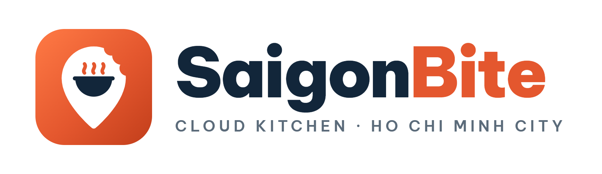

<p align="center"></p>

# SaigonBite – cloud-kitchen food delivery hub

Team G7 · Introduction to Software Engineering · Sem01_2627 · Ton Duc Thang University
Instructor: Phạm Thái Kỳ Trung · **Technology tier: Tier 4**

SaigonBite is a delivery-only kitchen network in Ho Chi Minh City. One platform serves Local Customers (Vietnamese phone, MoMo, VNPay, cash) and Foreign Tourists (passport and email, Apple Pay, PayPal, cash). Prices react to kitchen load: a quiet kitchen gives 10% off, a full kitchen (≥ 90%) stops taking orders, and every price is calculated in the fixed BR10 order.

| | Owner | Scope |
|---|---|---|
| **UC1 Place and Manage Orders** | Lê Xuân Khánh (524H0055) | place, track, edit, cancel · pricing and payment module BR1–BR14 · Revenue Report R1 · Tier 4 (a) PayPal sandbox |
| **UC2 Manage Hubs & Capacity** | Ngô Bình Minh (524H0169) | hub CRUD and load · Hub Utilization Report R2 · accounts, menu, vouchers, heavy-rain flag · Tier 4 (b) Admin dashboard |
| Tier 4 (c) Playwright E2E tests | both | Local and Tourist orders, kitchen and shipper transitions, invalid transition, R1, R2 |

**Stack:** ASP.NET Core MVC (.NET 8) · Entity Framework Core Code First · SQL Server · Bootstrap 5 · PayPal Developer sandbox (Orders v2) · Chart.js · xUnit · Playwright for .NET.

## Links

| | |
|---|---|
| **Figma – clickable prototype** (three flows: Local customer, Foreign tourist with PayPal, Admin) | [Open in Present mode](https://www.figma.com/proto/ADppt5rvGp5uS6E7Bb8X7G/SaigonBite-%E2%80%93-Team-G7-%E2%80%93-Part-2-UI-UX?node-id=2-603&p=f&scaling=scale-down-width&content-scaling=fixed&page-id=2%3A104&starting-point-node-id=2%3A603&show-proto-sidebar=1) |
| **Figma – design file** (cover & design system, sketch → wireframe → mock-up, prototype) | [Open the file](https://www.figma.com/design/ADppt5rvGp5uS6E7Bb8X7G/SaigonBite-%E2%80%93-Team-G7-%E2%80%93-Part-2-UI-UX) |
| **Part 2 report v2.0** (design, architecture, UI/UX) | [docs/part2/TeamG7_Part2_Design.pdf](docs/part2/TeamG7_Part2_Design.pdf) |
| **Part 2 Design Review slides** | [docs/part2/TeamG7_Part2_Presentation.pptx](docs/part2/TeamG7_Part2_Presentation.pptx) |
| **Part 1 report v1.1** (Tier 4 revision: FR36, FR37, NFR7, Feedback Log) | [docs/part1/TeamG7_Part1_Report_v1.1_Tier4.pdf](docs/part1/TeamG7_Part1_Report_v1.1_Tier4.pdf) |
| **Landing page motion** (19 s recording) | [design/ui/out/landing_motion.mp4](design/ui/out/landing_motion.mp4) |

## Repository layout

```
docs/part1/            Part 1: requirements report v1.0 and the Tier 4 revision v1.1
docs/part2/            Part 2 submission: report v2.0 (PDF), Design Review slides, readme.txt
design/brand/          logo (SVG/PNG), brand sheet
design/uml/out/        use case, sequence, state, class and ER diagrams (SVG + PNG)
design/architecture/   architecture, request pipeline and pricing pipeline (HTML + PNG)
design/ui/screens/     Bootstrap 5 prototype: landing page, sign-in, customer, kitchen, shipper, admin, reports
design/ui/out/         screenshots (desktop, 390 px mobile, wireframe, sketch), landing-page motion video
design/figma-plugin/   Figma development plugin that builds the whole Part 2 Figma file
design/credits/        credits for every photograph (Wikimedia Commons, free licences)
tools/                 generators for diagrams, screenshots, the Figma plugin, the report and the slides
src/                   application source code (Part 3)
```

## Rebuilding the design artefacts

Requirements: Python 3.12 with Pillow, python-docx, openpyxl and Playwright; Microsoft Edge; Graphviz `dot`; Node.js; Microsoft Word and PowerPoint for the PDF exports.

```bash
python tools/diagrams/sequences.py design/uml/out          # sequence diagrams (SVG)
python tools/diagrams/ucdiag.py design/uml/out             # use case diagram (SVG)
python tools/diagrams/structural2.py design/uml/out        # class, state and ER diagrams (Graphviz)
python tools/diagrams/svg2png.py 2.5 design/uml/out/*.svg  # PNG renders of the SVG diagrams
python tools/ui/shoot.py design/ui                         # screenshots + prototype hot-spots
python tools/report/composites.py .                        # UI stage, phone and landing composites
python tools/figma/build_plugin.py .                       # Figma plugin bundle
python tools/finalize_part2.py --figma <file-url> --figma-proto <prototype-url>   # report + slides PDF, zip
```

The Figma file is created by importing `design/figma-plugin/manifest.json` in Figma Desktop (Plugins → Development → Import plugin from manifest) and running it once. The file has three pages, the maximum on the free Starter plan.

## Image credits

Food and city photographs come from Wikimedia Commons under CC0, CC BY and CC BY-SA licences; the full list with authors and sources is in [design/credits/IMAGE_CREDITS.md](design/credits/IMAGE_CREDITS.md). Payment provider logos are public-domain text logos used only to label payment buttons; they remain trademarks of their owners.
